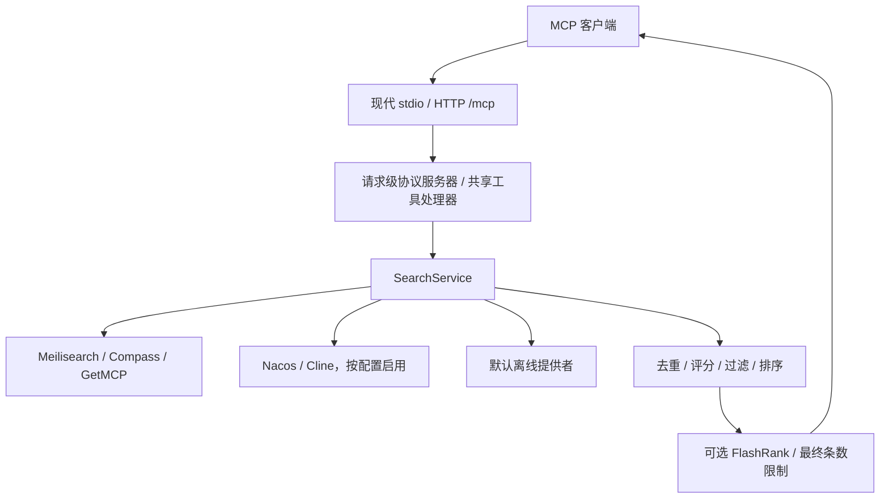

# 系统架构

[English](./ARCHITECTURE.md) | [简体中文](./ARCHITECTURE.zh-CN.md)

本指南按 2026-10-25 的 main `94829fd` 核对源码，描述当前实现而非历史设想。
默认、可选能力和历史 npm 包的区别见[README](../README_zh.md)。

## 架构概述

[CLI](../src/index.ts) 负责配置及装配；传输层处理协议，工具处理器负责参数校验与结果呈现，
SearchService 编排提供者，提供者负责各自数据源，重排组件负责合并和排序。
安装工具只生成指导，不执行安装。

## 核心组件

### 搜索服务

[SearchService](../src/services/searchService.ts) 的构造参数依次是提供者数组、
`Partial<OfflineConfig>`、可选 `ProfessionalReranker`，不是单一 options 对象。
`search` 接收结构化 `SearchParams`（`taskDescription`，可选 `keywords`、
`capabilities`）及 `SearchOptions`；默认 `limit: 5`、`minSimilarity: 0.4`。
`addProvider` 添加来源。准确可编译示例见[技术参考](./TECHNICAL_REFERENCE.zh-CN.md)。

所有启用的提供者通过 `Promise.all` 并行搜索，包括离线提供者，而非线上全部失败后才搜索离线。
各提供者失败会被记录并转换为空结果，不阻断其他来源。

### 搜索提供者

所有来源实现 `SearchProvider.search(params: SearchParams)`：

- [Meilisearch](../src/services/core/search/MeilisearchSearchProvider.ts)：当前路径组合任务、
  关键词和能力为文本查询，客户端请求最多 10 条结果。支持本地/云配置及失败切换。
  仓库另有向量引擎，但不能据此把当前提供者说成 HNSW 向量搜索。
- [Compass](../src/services/core/search/CompassSearchProvider.ts)：请求
  `COMPASS_API_BASE` 的 `/recommend?description=...`，将 `github_url` 映射为 `sourceUrl`。
- [GetMCP](../src/services/core/search/GetMcpSearchProvider.ts)：下载并缓存目录，在向量引擎索引和检索。
  `GETMCP_API_URL` 默认 `https://getmcp.io/api/servers.json`；这是外部目录，不代表官方注册表或实时更新保证。
- [Nacos](../src/services/core/search/NacosMcpProvider.ts)：CLI 只有同时提供
  `NACOS_SERVER_ADDR`、`NACOS_USERNAME`、`NACOS_PASSWORD` 才初始化，成功后加入。
  CLI 不读取 namespace/group/service-name 环境变量；程序化配置见快速开始。
- [Cline](./cline-marketplace.md)：仅 `CLINE_MARKETPLACE_ENABLED=true` 启用，
  搜索时抓取并缓存市场目录，使用词法匹配；不是语义检索，也不执行目录中的安装命令。
- [离线提供者](../src/services/core/search/OfflineSearchProvider.ts)：默认启用，
  本地数据结合文本匹配和向量检索。模型首次初始化可能联网下载；
  “离线”不保证网络隔离或隐私隔离，CLI 的在线来源仍同时运行。

## 搜索策略与数据流

1. 推荐工具校验结构化参数并调用 SearchService。
2. 启用来源并行召回；具体产品过滤在来源结果汇总后执行。
3. `RerankMcpServer` 按 `sourceUrl` 去重，无 URL 时使用 `title:<title>`。
   重复项优先较高 similarity，相等时按提供者优先级。
4. 现有 score 保留，否则 similarity 乘来源优先级（无非零优先级时因子为 1）；
   过滤阈值为 `minScore ?? minSimilarity`，默认按分数降序，应用条数限制。
5. 若注入 FlashRank，SearchService 另取最多 50 条已去重、过滤的候选调用服务，
   再应用最终 limit。仅正数 limit ≤50、score 排序、至少两候选且查询非空时启用。
   服务失败回退到原排序，详见[重排指南](./professional-reranking.md)。
6. 工具将服务器结果格式化为 MCP 文本内容返回。

旧 `ProfessionalRerankProcessor` 仍是默认关闭的占位器，但不等于整个项目没有模型重排：
真正的可选 FlashRank 集成位于 SearchService。

离线提供者构造权重默认为文本 0.7、向量 0.3，不按查询动态切换。
识别关键词且文本命中时返回文本，后台向量结果只记录；否则并行搜索并按 ID 合并，
重复项取最大加权 similarity 而非相加，再交全局重排。过滤后可以无结果，
不保证固定五条或最低召回量。

来源优先级为 Offline 5、GetMCP 10、Compass 8、Meilisearch 9。
未知类名在去重阶段优先级为 0，在无既有 score 时评分因子回退为 1。
优先级不是独立的“优先级第一”排序。

## 传输与安全边界

[服务器工厂](../src/services/core/server/stateless/McpServerFactory.ts)、
[HTTP 适配器](../src/services/core/server/stateless/StatelessHttpServer.ts)
使用官方 SDK core/server/client 2.3.1、Node 适配器 2.1.1，要求 MCP 2026-07-28。

- stdio 默认启用；诊断输出不能污染 stdout。
- HTTP 固定 `/mcp`，每请求创建协议服务器；业务服务和缓存可以共享。
- 无旧 initialize/initialized 握手、MCP session ID、会话恢复或独立 GET 流。
  `GET` 和 `DELETE /mcp` 返回 405；现代 POST 响应仍可用 SSE 编码。
- 旧 SSE/REST 模式被拒绝，旧 HTTP 路径返回 410。旧代码隔离在 legacy 目录，
  排除于生产编译和导入，保留它不代表当前入口兼容旧协议。
- `GET /health` 和 `POST /api/sources` 是独立应用路由。
- 默认监听 `127.0.0.1`，Host/Origin 守卫不是认证。
  无内置认证或跨源浏览器 CORS；远程暴露需要独立安全措施。
- 传输取消不保证所有业务提供者中止底层任务。

详见[迁移指南](./MCP_2026_MIGRATION.md)与[配置参考](./GETTING_STARTED.zh-CN.md)。
未合并的托管 PR #40 不属于这里已验收的运行方式。

## 技术实现与验证边界

[vectorUtils.ts](../src/utils/vectorUtils.ts) 提供 L2 归一化及余弦相似度。
零或非有限模长返回副本；不能据此声称所有后端入库前都进行归一化。

本指南是源码结构说明，不是性能、真实外部服务或模型质量验收。
[搜索质量评估](./search-quality-evaluation.md) 的示意数据也不是生产效果证据。
开发验证与贡献要求见[贡献指南](../CONTRIBUTING.zh-CN.md)。
